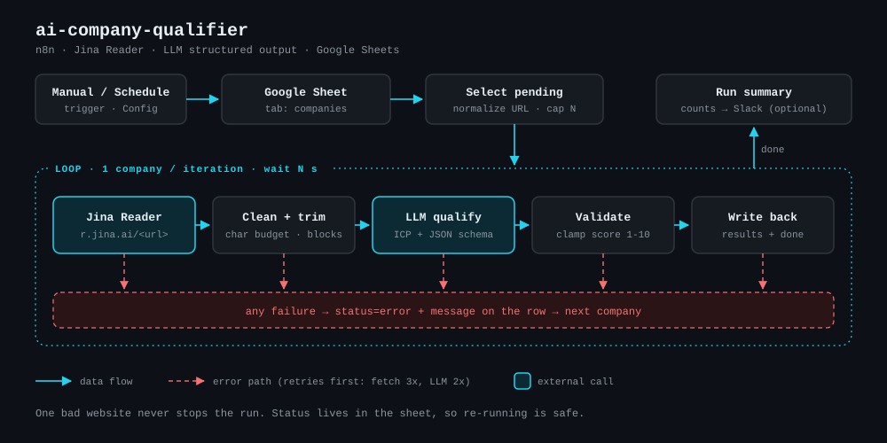

# AI Company Qualifier for n8n

**Paste a list of company websites into a Google Sheet and get back a 1–10 fit score against your
Ideal Customer Profile, plus the industry, a size estimate, the reasons for the score and a
personalized pitch for each company.**

An importable n8n workflow. It reads each website as clean markdown with
[Jina Reader](https://jina.ai/reader/), asks an LLM for **schema-validated structured output**,
and writes the results back to the sheet. It is built for unattended batch runs: one bad website
never stops the run, and every row ends up as either `done` or `error` with a readable message.



## Features

- **Website → markdown with no scraper to run.** `https://r.jina.ai/<url>` returns the page as LLM-ready markdown.
- **Structured output.** A JSON schema (Structured Output Parser) enforces `score`, `industry`,
  `company_size_guess`, `reasons` and `pitch`.
- **The LLM is treated as untrusted.** A validation step clamps the score to 1–10, maps unknown size values to `unknown` and caps text lengths.
- **Token budget.** Page content is cleaned (no images or link URLs) and trimmed to a configurable character budget before it reaches the model.
- **Empty and blocked pages are caught early.** Bot walls, error pages and near-empty sites are flagged and never sent to the LLM, so they cost no tokens.
- **Per-item error isolation.** Fetch, LLM, validation and sheet-append failures all lead to `status=error` plus a message on that row. The loop keeps going.
- **Retries and rate limiting.** Jina gets 3 tries with a 45 s timeout, the LLM gets 2 tries, and the workflow waits between companies.
- **Idempotent re-runs.** Status lives in the sheet, so only `pending` / empty / `retry` rows are picked up.
- **Run summary.** Counts done, error, still-pending and high-fit companies, with an optional Slack message.
- **One place to configure.** ICP, limits and wait time all live in the **Config** node. Sticky notes explain every section.

## How it works

| # | Section | Nodes | What happens |
|---|---------|-------|--------------|
| 1 | Load | Manual Trigger / Daily Schedule → **Config** → Read Company Rows → **Select Pending Rows** | Reads the `companies` tab. Keeps rows whose status is empty, `pending` or `retry`. Normalizes URLs, removes duplicates and caps the run at `max_rows_per_run`. |
| 2 | Fetch & clean | **Loop Over Companies** → Fetch Website (Jina Reader) → **Prepare Page Content** → Has Usable Content? | Fetches `r.jina.ai/<url>` (timeout, retries). Strips images, link URLs and braces, then trims to `max_markdown_chars`. Flags empty, blocked or thin pages. |
| 3 | Qualify | **Qualify Company (LLM)** + OpenAI Chat Model + Structured Output Parser → **Validate Result** | Scores the company against the ICP with the rubric in [`prompts/qualifier-prompt.md`](prompts/qualifier-prompt.md) and validates the result. |
| 4 | Write back | Append Result Row → Mark Row Done → Rate Limit Wait → (next company) | Appends the full result to the `results` tab, then sets `status=done`, `score` and `processed_at` on the `companies` row. |
| 4b | Errors | **Build Error Row** → Mark Row Error → Rate Limit Wait | Takes the error output of every step and writes `status=error` and `error_message` on the row. |
| 5 | Summary | Re-read Company Rows → **Build Run Summary** → Notify Slack (optional, disabled) | Counts this run's outcomes by reading the sheet. Reading the sheet counts every loop iteration, not just the last one. |

## Setup

### 1. Create the Google Sheet

Create one spreadsheet with two tabs. The header names must match exactly (lowercase).

**Tab `companies`** (input and status):

| company_name | website | status | score | error_message | processed_at |
|---|---|---|---|---|---|

Fill in `company_name` and `website`, and leave the other columns empty. You can import
[`samples/companies.csv`](samples/companies.csv) to get started (it uses fictional companies on
reserved `example.*` domains).

**Tab `results`** (output):

| company_name | website | score | industry | company_size_guess | reasons | pitch | qualified_at |
|---|---|---|---|---|---|---|---|

[`samples/output-example.csv`](samples/output-example.csv) shows what results look like. The data
in it is illustrative, not real output.

> `website` is the key used to update rows in `companies`, so keep it unique within the tab.

### 2. Create credentials in n8n

| Credential | Used by | Notes |
|---|---|---|
| **Google Sheets OAuth2 API** | the 4 Google Sheets nodes | Standard Google OAuth client with the Sheets API enabled. A service account also works: switch the node's *Authentication* setting and share the sheet with the service account. |
| **OpenAI API** | OpenAI Chat Model | You can use any chat model n8n supports (Anthropic, Gemini, Mistral, Ollama, …). Swap the model sub-node; the chain and parser stay the same. |
| **Jina API key** (optional) | Fetch Website (Jina Reader) | Jina Reader works without a key at a lower rate limit. To use a key, set *Authentication* → *Generic* → *Header Auth* with `Authorization: Bearer <your key>`. |
| **Slack API** (optional) | Notify Slack | Only needed if you enable that node. |

The workflow ships with placeholder credential IDs (`REPLACE_WITH_CREDENTIAL_ID`). n8n asks you to
select real credentials when you open each node.

### 3. Import and configure

1. In n8n, go to **Workflows → Import from File** and select [`workflows/ai-company-qualifier.json`](workflows/ai-company-qualifier.json).
2. In each of the 4 Google Sheets nodes, replace `YOUR_SPREADSHEET_ID` with your sheet's ID (the long string in the sheet URL) and select your credential.
3. Select your OpenAI (or other LLM) credential in **OpenAI Chat Model**, and pick a model if you want a different one.
4. Edit the **Config** node:

   | Field | Default | Meaning |
   |---|---|---|
   | `icp` | B2B SaaS companies in the US with 20-500 employees that sell to marketing teams. | Your Ideal Customer Profile. |
   | `max_rows_per_run` | 25 | Upper bound of companies per execution. |
   | `max_markdown_chars` | 12000 | Character budget for page content (roughly 3k tokens). |
   | `min_markdown_chars` | 300 | Below this, the page is "too thin" and is marked as an error. |
   | `wait_seconds` | 2 | Pause between companies (rate limiting). |
   | `high_fit_threshold` | 7 | Score counted as "high fit" in the summary. |

5. Click **Execute workflow** to test on the sample rows. When you are happy with the results, activate the workflow so the daily schedule runs it (07:00 by default).

## Customizing the ICP and rubric

- **ICP**: edit `icp` in **Config**. Name the business model, geography, size band and buyer. Add
  explicit exclusions if you have them.
- **Rubric and field rules**: these live in the system message of **Qualify Company (LLM)**. The
  same text, with notes and tuning tips, is in [`prompts/qualifier-prompt.md`](prompts/qualifier-prompt.md).
- **New output fields**: add the field to the JSON schema in **Structured Output Parser**, pass it
  through **Validate Result**, and add a column to the `results` tab and to **Append Result Row**.
- Keep `{` and `}` out of prompt text. The LLM chain treats braces as template variables.

## Cost and rate limits

- **LLM**: one call per qualified company. Input is at most about `max_markdown_chars / 4` tokens
  of page content plus a prompt of about 600 tokens. Output is about 250 tokens. Small "mini"-class
  models keep the cost per company in the fractions of a cent. Check your provider's current
  pricing. Pages flagged as empty or blocked never reach the LLM.
- **Jina Reader**: the free tier without a key is rate-limited per IP. Add an API key for higher
  limits, and keep `wait_seconds` above 0 for large lists.
- **Google Sheets API**: each company uses 2 write calls. The per-minute quota is the usual
  bottleneck above roughly 30 companies per minute. `wait_seconds` keeps you well below it.
- **Throughput**: by design, companies are processed one at a time (see below). Expect a few
  seconds per company. For thousands of rows, schedule several runs with `max_rows_per_run`.

## Error handling design

| Failure | Where it is caught | Row result |
|---|---|---|
| DNS error, timeout or HTTP 4xx/5xx from Jina | HTTP node error output, after 3 tries | `error`: the HTTP error message |
| Bot wall, error page or empty page returned as 200 | Prepare Page Content → Has Usable Content? (false branch) | `error`: "Website blocked the reader…", "Empty page content" or "Too little readable content…" |
| LLM API error or output that fails the schema | LLM chain error output, after 2 tries | `error`: the provider or parser message |
| Output without a usable score | Validate Result error output | `error`: "LLM output has no numeric score…" |
| `results` append fails | Append Result Row error output | `error`, so the row is not marked `done` |
| Status update fails | Continue on error | Row stays `pending` and is picked up next run |

Design choices:

- **One company per loop iteration.** Success and error branches both lead back to the loop node.
  With one item per iteration, exactly one branch runs each time, so the loop advances exactly once.
  With larger batches, a batch that mixes successes and failures would re-enter the loop from both
  branches. Per-item processing trades raw throughput for predictable, isolated behavior.
- **Status in the sheet, not in workflow memory.** Re-running is safe. Set a row's status to
  `retry` (or clear it) to process it again.
- **Results are appended before the row is marked done.** If anything fails between those two
  writes, the row is retried rather than silently lost. The cost is a possible duplicate in `results`.

## Limitations

- **JavaScript-heavy or protected sites** may return little or no content through Jina Reader.
  They are marked as errors, not guessed at.
- **Only the URL you provide is read** (usually the homepage). Size and geography are inferred
  from that page, so `company_size_guess` is an estimate and is often `unknown`.
- **LLM scores are judgments, not facts.** Review high scores before outreach and recalibrate the
  rubric with a sample your team has scored by hand.
- **Duplicates.** A website listed twice in `companies` is qualified only once per run. Keep
  `website` unique, because it is the key used for the status update.
- **Version requirements.** The workflow uses recent node versions (Google Sheets 4.7, HTTP Request
  4.5, Basic LLM Chain 1.9, Edit Fields 3.5). Older n8n versions may not import it unchanged.
- **Only partly run in a live instance.** The workflow was import-tested on n8n 2.44.5: every
  node type and version is recognized, and parameters and connections survive import with no
  parameter issues. The loop ran locally on the sample rows, with real Jina Reader fetches, page
  cleaning, the content check, result validation, the error branch and the run summary. The
  Google Sheets nodes and the LLM call were replaced by mocks for that run because they need
  credentials. Expect to select credentials and the sheet on first import.

## Repository layout

```text
workflows/ai-company-qualifier.json   importable n8n workflow
prompts/qualifier-prompt.md           scoring prompt, rubric, output schema, tuning tips
samples/companies.csv                 sample input (fictional companies, reserved domains)
samples/output-example.csv            illustrative results tab
docs/architecture.svg                 diagram above
```

## License

[MIT](LICENSE) © 2026 Humberto Rivero
